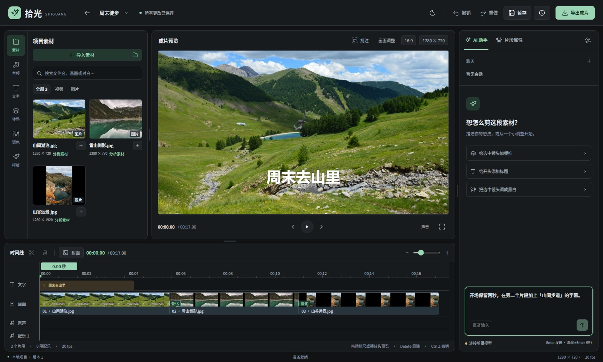

# 拾光（Shiguang）

拾光是在本机运行、通过浏览器使用的 Vlog 剪辑工具，适合把旅行、日常记录和口播素材整理成片。把视频、照片和音频导入工程后，你可以直接在时间线上剪辑，也可以让 AI 按照你的指令先剪一版，再预览草稿、手动调整。



## 从素材到成片

把周末徒步拍下的画面导入工程，对 AI 助手输入一句剪辑要求。

> 开场保留两秒，在第二个片段加上「山间步道」的字幕。

你可以在工作台查看 AI 生成的剪辑草稿。看到需要调整的画面时，可以暂停预览、框选并批注，也可以回到时间线直接修改。

## 主要功能

- 在时间线上裁切、重排和变速，添加转场、配乐与字幕。
- 调整画面构图、运镜和颜色，从成片中选一帧制作封面。
- 导出 MP4 成片和独立的 PNG 封面。

## 快速开始

需要 `uv`、Python 3.12+、Node.js 22.12+ 和 Chrome 或 Chromium。下载或克隆仓库后，在仓库根目录运行以下命令。

```sh
uv sync --locked
npm ci
npm start
```

在 Windows PowerShell 中可用 `npm.cmd ci` 和 `npm.cmd start`。启动后新建项目并导入素材。需要使用 AI 时，在工作台选择「连接剪辑模型」。

## 许可证

项目自有代码和文档采用 [MIT 许可证](LICENSE)。第三方资源适用各自的许可证。

截图中的示例照片来自 Pexels。[山间湖泊](https://www.pexels.com/photo/green-grass-field-and-mountain-13037627/) · [雪山倒影](https://www.pexels.com/photo/green-mountains-and-lake-530736/) · [山谷远景](https://www.pexels.com/photo/landscape-with-lake-between-mountains-5864356/)
